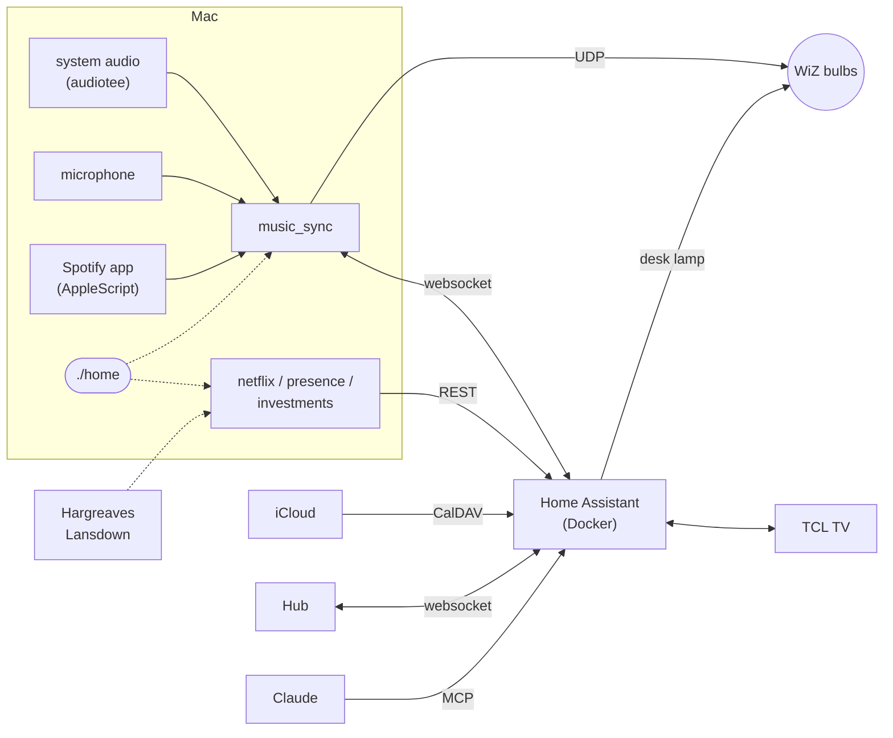

<p align="center"></p>

<h1 align="center">home-automation</h1>

<p align="center">
The setup that runs my room in London: three WiZ bulbs, a TCL Google TV and a Mac, glued together with Home
Assistant and a few Python services.
</p>

<p align="center">


</p>

<p align="center"></p>

That's the Hub, the dashboard I actually use. The orbs are the bulbs in whatever colour they are right now,
and the background picks up colour from the lights and the album art.

## What's in here

- **Music sync.** The two lamps by the TV follow whatever is playing. It does proper beat tracking (onsets,
  tempo, a beat grid it can predict ahead of time), so the lights land on the kick instead of lagging behind
  it. Colours come from the album cover, or from the key of the song if the cover is black and white. It
  listens to the Mac directly, or through the mic when the music is coming out of the TV.
- **TV mode.** When the TV comes on, the same lamps switch to dim warm light that drifts a little with loud
  scenes. I wanted something I wouldn't notice while watching, so there's no colour and nothing flashes. If
  the TV is playing Spotify it goes back to the music show.
- **Desk lamp.** The third bulb sets its own colour temperature and brightness from the sun, cloud cover and
  rain, and gets warmer and dimmer in the evening. These lamps are the only lights in the room, so it stays
  fairly low. If I change it by hand it leaves it alone for two hours.
- **The Hub.** Plain HTML/JS on Home Assistant's websocket API, no build step. Lights, now playing with
  controls, the week's calendar (iCloud), my investments, the desk lamp, the TV and Netflix.
- **Investments.** Holdings from Hargreaves Lansdown, which has no API, so it logs in like the website does.
  It's written so it can't lock the account (more on that below). Values are blurred on the dashboard until
  I tap to show them.
- **Talking to it.** Claude can control everything through Home Assistant's MCP server, so "turn the TV lamps
  blue" or "lights out" just works.
- **Away mode.** If my phone hasn't been on the Wi-Fi for a while and the Mac is idle, everything turns off.

## How it fits together



Home Assistant runs in Docker. The audio side can't, because it needs Core Audio and the mic, so those
services run natively on the Mac under a small supervisor, and `./home` starts and stops the lot together.

## Running it

```sh
python3 -m venv .venv && .venv/bin/pip install -r requirements.txt
cp .env.example .env                       # TOKEN = a Home Assistant long-lived token
./home up
.venv/bin/python -m homeassistant.apply    # pushes helpers, automations, dashboards and the Hub
```

The Hub is at `http://localhost:8123/hub-live`, or full screen at `/local/hub/index.html` (it has a manifest
and icon, so it can go on a phone's home screen). Turn on *Allow local communication* in the WiZ app first.
The first run will ask for system audio, microphone and Spotify automation permissions.

```sh
./home up | down | restart | status       # down restores the bulbs before stopping anything
./home logs music_sync
bin/ha states light                       # quick look at anything in HA
bin/ha call script.turn_on script.party_mode
```

<p align="center"></p>

## Notes

<details>
<summary><b>Music sync</b></summary>
<br>

`python -m music_sync` connects to Home Assistant and creates its own controls:

| Entity | |
| --- | --- |
| `input_boolean.music_sync` | On/off. The bulbs go back to how they were when it stops, after 30s of silence, or on the next run after a crash. |
| `input_select.music_sync_mode` | `auto`, `calm`, `party` (chases, strobes on drops), `tv`, `classic` (the original wiz_spotify algorithm). |
| `input_select.music_sync_colours` | `Album art` or `Music key`. |
| `input_number.music_sync_sensitivity` | Onset threshold. Up if it reacts to noise, down if it misses beats. |
| `input_number.music_sync_latency` | Sends beats this many ms early to cover bulb lag. Negative for Bluetooth speakers. |
| `sensor.music_sync_tempo` | Detected BPM and whether the beat grid is locked. |
| `sensor.music_sync_now_playing` | Track, cover, palette and playback position. |

The analysis (`analysis.py`, `show.py`) works on 23 ms STFT hops: spectral-flux onsets in three bands with
adaptive thresholds, tempo from autocorrelation, beat phase from a comb filter plus a PLL that nudges the
grid towards detected kicks. Once it's locked, beats are predicted and sent early. Hue comes from a chroma
vector mapped onto the circle of fifths, so it follows the key. There's per-band AGC and a simple
breakdown-then-drop detector. Each bulb is rate limited and identical updates are skipped.

Where it listens: `tv` mode always uses the mic. The other modes use the Mac's audio, but if that's silent for
3s while the TV is on they switch to the mic (with a slow gain stage, since a laptop across the room hears
the TV at about -55 dBFS) and switch back after 1.5s of sustained Mac audio. I couldn't use Spotify's own
state for this because the Mac app reports "playing" while it's acting as a remote for the TV.

Album colours: `nowplaying.py` asks Spotify over AppleScript what's playing (no developer account, and it
won't launch Spotify if it's closed). `palette.py` runs k-means on the cover, merges near-duplicate hues,
throws out black/grey/white and keeps up to four colours. Bulbs rotate through them every bar, two bars or
beat depending on the mode.

`script.music_command` does play/pause/next/previous on the Mac's Spotify if it's open, otherwise on the TV.

System audio comes from the bundled [audiotee](https://github.com/makeusabrew/audiotee) binary (MIT, macOS
14.2+). Nothing is recorded; audio only lives in memory.

</details>

<details>
<summary><b>TV mode</b></summary>
<br>

Warm white between 2200 and 2700K at 15%. Loud scenes can push it up by at most 8 points over about 3
seconds, and it settles back over about 8. No RGB, no beats. It listens to the room, so it works with every
app, and it never times out on quiet scenes.

The TV is paired through HA's Android TV Remote integration (`media_player.smart_tv_pro`). The *TV bias
lighting* automation starts it when the TV turns on, unless music sync is already running or I'm out, and
stops it when the TV turns off. It only fires on a real off→on change, otherwise every HA restart would
trigger it.

</details>

<details>
<summary><b>Desk lamp</b></summary>
<br>

This one lives entirely in Home Assistant (`homeassistant/templates/`, `automations/desk_lamp_*.json`).

- `sensor.outdoor_daylight` estimates the light coming through the window from the sun's elevation (0 at
  -4°, full at 30°), cloud cover (up to -70%) and rain, fog or snow (another -20%).
- `sensor.desk_lamp_target_colour` is 4000-5200K during the day (cooler when it's overcast, to match the
  light outside), 2700K around sunset, and 2200K from the 21:00-22:30 wind-down until 05:00.
- `sensor.desk_lamp_target_brightness` scales everything to `input_number.desk_lamp_max_brightness`: the full
  value in the dark, less on bright days, 45% of it late at night, and at most 35% of it while the TV is on.

It only adjusts the lamp when it's already on. A manual change that's clearly off target starts
`timer.desk_lamp_manual`, which pauses it for 2 hours. Music sync skips this bulb (`WIZ_EXCLUDE_MACS`).

</details>

<details>
<summary><b>Investments (Hargreaves Lansdown)</b></summary>
<br>

HL doesn't have an API, so `investments/hl.py` logs in the same way the website does and reads the portfolio
pages. It's a port of [hl-api-client-net](https://github.com/jonathanmadeley/hl-api-client-net). HL locks
the account after a few failed logins, so I was careful with this one:

- Credentials are checked locally first: the secure number has to be 6 digits and the date of birth has to
  be unambiguous.
- The password is only submitted if the page asks for exactly three secure-number digits it can identify.
- Any failed, interrupted or unexpected login stops automatic logins completely. Nothing retries. It stays
  stopped until `python -m investments login` works when run by hand.
- At most 8 automatic logins a day, and the session cookie is reused so most refreshes don't log in.

```sh
.venv/bin/python -m investments setup   # prompts for the details and stores them in the macOS Keychain
.venv/bin/python -m investments login   # one login by hand, then fetch and publish
```

After that it refreshes hourly between 07:00 and 22:00 as part of `./home up` and publishes
`sensor.investments`, which isn't exposed to Claude.

Price history for each fund comes from the FT's public fund pages (`investments/prices.py`), looked up by ISIN
(worked out from the SEDOL for UK funds) and fetched once a day into `sensor.investment_<sedol>`. Only fund
identifiers are sent to FT. In the Hub, clicking a holding opens its price chart (1M to 5Y) with my average
cost marked, returns over each period and the position itself. The main chart shows what my current holdings
would have been worth over time, so it ignores deposits. `tests/test_investments.py` runs each of those rules
against a fake HL.

</details>

<details>
<summary><b>Claude</b></summary>
<br>

Home Assistant's MCP server (`/api/mcp`) gives Claude the usual Assist tools: on/off, light colour and
brightness, media controls, scripts and the calendar. `homeassistant/voice.json` controls which entities it
can see and what they're called ("TV lamp 1", "desk light", "lights out" and so on).

```sh
claude mcp add-json -s user home-assistant \
  '{"type":"http","url":"http://localhost:8123/api/mcp","headersHelper":"'"$PWD"'/bin/ha-mcp-headers"}'
```

`bin/ha-mcp-headers` reads the token from `.env` when it's needed, so it isn't stored in Claude's config.

</details>

<details>
<summary><b>Calendar, Netflix and presence</b></summary>
<br>

Calendar: iCloud over CalDAV. `homeassistant.apply` adds it once `ICLOUD_USERNAME` and `ICLOUD_APP_PASSWORD`
(an app-specific password) are in `.env`.

Netflix: there's no API, so `python -m netflix --watch` reads the export files from `~/Downloads`. The
viewing activity download is instant and gives titles and dates; the full personal data export takes a few
days but includes playback position.

Presence: `python -m presence` publishes `binary_sensor.someone_home`. I count as home if my phone has been
on the Wi-Fi in the last 15 minutes or the Mac has been used in the last 10. When that flips to away,
everything turns off. If the service isn't running the sensor just doesn't exist, so nothing turns off by
accident. Needs `PRESENCE_PHONE_MAC` in `.env`.

</details>

<details>
<summary><b>Home Assistant config</b></summary>
<br>

The parts of the HA config I care about are JSON files in `homeassistant/`, pushed with
`.venv/bin/python -m homeassistant.apply`. I edit these rather than using the UI so the repo stays in sync.

| | |
| --- | --- |
| `helpers.json` | toggles, timers, sliders |
| `templates/` | daylight and desk lamp target sensors |
| `scripts/` | Party, Chill, Movie, All off, `music_command` |
| `automations/` | TV lighting, desk lamp, manual hold, away |
| `dashboards/home.json` | the standard HA dashboard (`/home-hub`) |
| `voice.json` | what Claude can see and control |

</details>

## Layout

```
home                ./home up | down | status | logs
music_sync/         audio capture, analysis, light show, now playing
investments/        Hargreaves Lansdown client
netflix/            export parser
presence/           phone on Wi-Fi -> home/away
stack/              the supervisor behind ./home
homeassistant/      HA config + apply.py
frontend/hub/       the Hub, plus screenshot.py
bin/                audiotee, ha, ha-mcp-headers
tests/
```

Tests: `python -m tests.test_analysis` (a synthetic 128 BPM track: tempo, beat timing, drops, TV mode,
palettes), `tests.test_netflix` and `tests.test_investments`.
