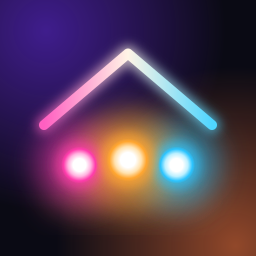
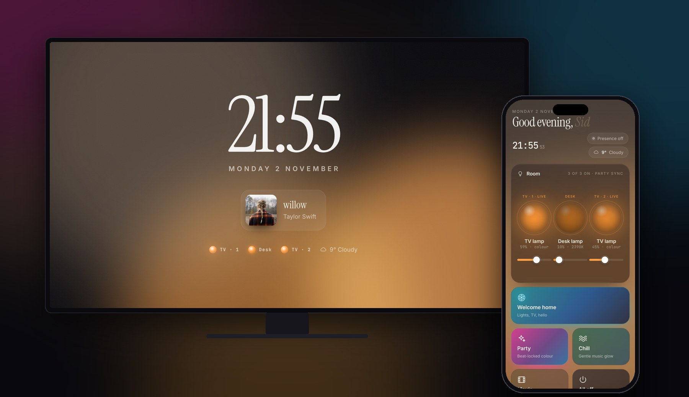
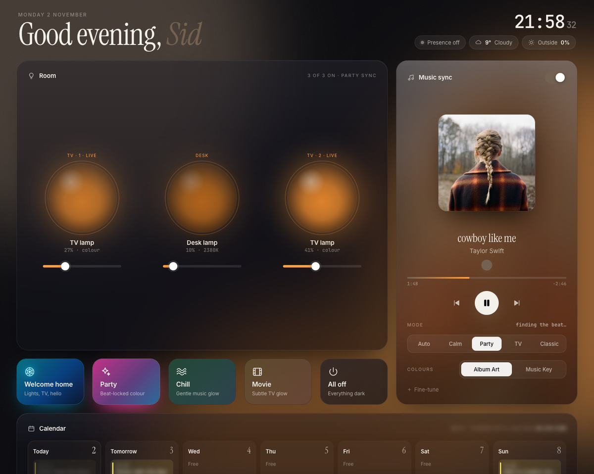
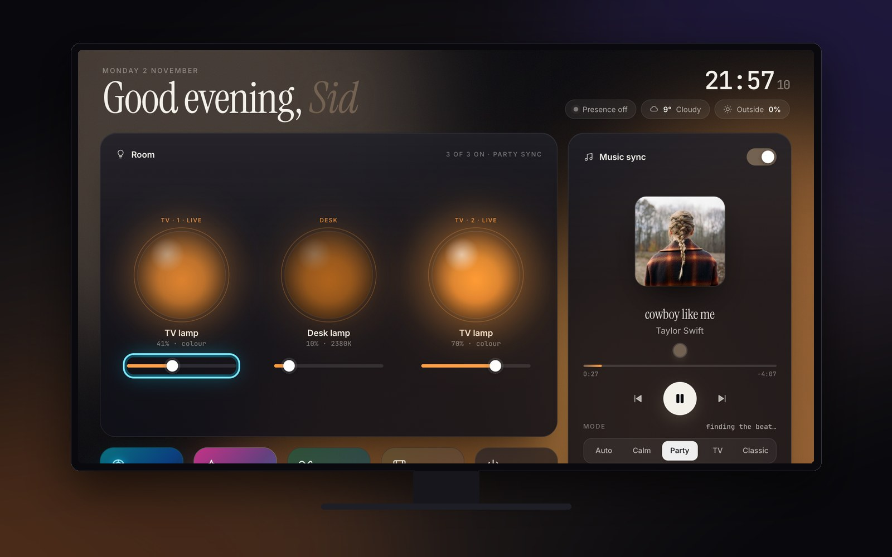
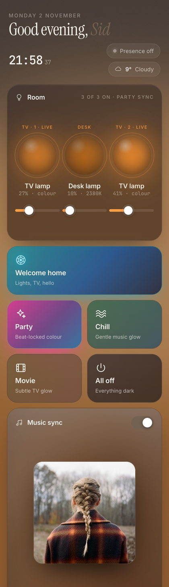
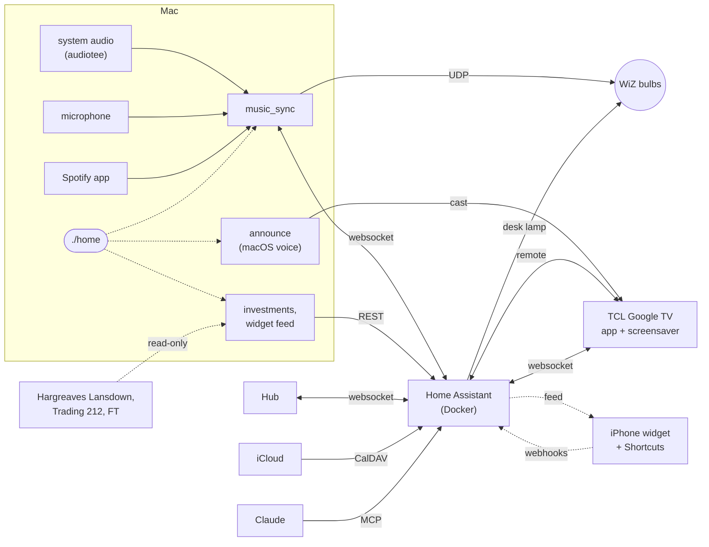

<p align="center"></p>

<h1 align="center">home-automation</h1>

<p align="center">
The setup that runs my room in London: three WiZ bulbs, a TCL Google TV and a Mac, glued together with Home
Assistant, a handful of Python services and a dashboard I built for it.
</p>

<p align="center">


</p>

<p align="center"></p>

## An evening with it

- I get in and tap **Welcome home**. The lamps by the TV come up in blue, settle to warm white, and the TV wakes
  up and says "Welcome home, Sid."
- I put Spotify on and the two TV lamps follow the beat, in colours taken from the album cover.
- I switch to Netflix and they drop to a dim warm glow that barely moves, so I stop noticing them.
- The desk lamp has been following the sky all day. By half ten it's down to candle colour.
- If I leave the TV alone for a minute it turns into a clock showing what's playing and which lamps are on.

## Three screens

<p align="center"></p>

**The Hub** is the dashboard: plain HTML and JavaScript on Home Assistant's websocket API, with no build step.
The orbs are the bulbs in whatever colour they are right now, and the background takes its colour from the lights
and the album art. Around them: now playing with controls, the week's calendar, my investments and the cash at
Trading 212 (blurred until I tap the eye), the desk lamp's view of the sky, a remote for the TV, and a health card
that says what's running and how fresh everything is.

<p align="center"></p>

**On the TV** it's an Android TV app with its own tile in the launcher. The Hub notices it's on a TV and lays itself
out for the sofa: the remote's arrows move a glowing ring to whatever is nearest in that direction, OK presses it,
and Back closes things. The same app is the TV's **screensaver**, which is the clock at the top of this page.



**On the phone** the Hub is a home-screen web app. There's also an iPhone widget in the same style (glowing orbs,
what's playing, the TV and the weather) and a set of Shortcuts, so I can flip a lamp without opening anything.
Neither holds a Home Assistant password: they read a small feed and call single-purpose webhooks that only work
on my home network.

And I can just ask Claude. Home Assistant's MCP server gives it the lights, the TV, the scenes and the calendar,
so "turn the TV lamps blue" or "lights out" just works.

<br clear="right">

## What's in here

- **Music sync.** Real beat tracking (onsets, tempo, and a beat grid it can predict ahead of time), so the lights
  land on the kick instead of lagging behind it. It listens to the Mac directly, or through the mic when the music
  is coming out of the TV.
- **TV mode.** Bias lighting for watching things: warm white, very dim, no colour, nothing flashes. If the TV is
  playing music instead, it goes back to the show.
- **Desk lamp.** Sets its own colour temperature and brightness from the sun, cloud cover and rain, and stays low,
  because these three lamps are the only lights in the room. If I change it by hand it leaves it alone for two hours.
- **Welcome home.** One button: lights, the TV, and a spoken hello through the TV in a British voice.
- **Investments.** Holdings from Hargreaves Lansdown, which has no API (so it logs in like the website does, written
  so it can't lock the account), price history from the FT, and the daily interest on my cash at Trading 212.
- **One switch.** `./home up` and `./home down` start and stop everything, and a supervisor restarts anything that
  falls over.

## How it fits together



Home Assistant runs in Docker. The audio side can't, because it needs Core Audio and the mic, so those services run
natively on the Mac under a small supervisor, and `./home` starts and stops the lot together.

## Running it

```sh
python3 -m venv .venv && .venv/bin/pip install -r requirements.txt
cp .env.example .env                       # TOKEN = a Home Assistant long-lived token
./home up
.venv/bin/python -m homeassistant.apply    # pushes helpers, automations, dashboards and the Hub
```

The Hub is at `http://localhost:8123/hub-live`, or full screen at `/local/hub/index.html`. Turn on *Allow local
communication* in the WiZ app first. The first run asks for system audio, microphone and Spotify permissions.

```sh
./home up | down | restart | reload | status     # down puts the bulbs back before stopping anything
./home logs music_sync
bin/ha states light                              # quick look at anything in Home Assistant
bin/ha call script.turn_on script.welcome_home
tv-app/deploy                                    # build the TV app and install it on the TV
```

## Notes

<details>
<summary><b>Music sync</b></summary>
<br>

`python -m music_sync` connects to Home Assistant and creates its own controls:

| Entity | |
| --- | --- |
| `input_boolean.music_sync` | On/off. The bulbs go back to how they were when it stops, after 30s of silence, or on the next run after a crash. |
| `input_select.music_sync_mode` | `auto`, `calm`, `party` (chases, strobes on drops), `tv`, `classic` (the original wiz_spotify algorithm). |
| `input_select.music_sync_colours` | `Album art` or `Music key`. |
| `input_number.music_sync_sensitivity` | Onset threshold. Up if it reacts to noise, down if it misses beats. |
| `input_number.music_sync_latency` | Sends beats this many ms early to cover bulb lag. Negative for Bluetooth speakers. |
| `sensor.music_sync_tempo` | Detected BPM and whether the beat grid is locked. |
| `sensor.music_sync_now_playing` | Track, cover, palette and playback position. |

The analysis (`analysis.py`, `show.py`) works on 23 ms STFT hops: spectral-flux onsets in three bands with adaptive
thresholds, tempo from autocorrelation, beat phase from a comb filter plus a PLL that nudges the grid towards
detected kicks. Once it's locked, beats are predicted and sent early. Hue comes from a chroma vector mapped onto the
circle of fifths, so it follows the key. There's per-band AGC and a simple breakdown-then-drop detector. Each bulb
is rate limited and identical updates are skipped.

Where it listens: `tv` mode always uses the mic. The other modes use the Mac's audio, but if that's silent for 3s
while the TV is on they switch to the mic (with a slow gain stage, since a laptop across the room hears the TV at
about -55 dBFS) and switch back after 1.5s of sustained Mac audio. Spotify's own state can't decide this, because the
Mac app says "playing" while it's acting as a remote for the TV.

Album colours: `nowplaying.py` asks Spotify over AppleScript what's playing (no developer account, and it won't
launch Spotify if it's closed). `palette.py` runs k-means on the cover, merges near-duplicate hues, throws out
black, grey and white and keeps up to four colours. `script.music_command` does play/pause/next/previous on the
Mac's Spotify if it's open, otherwise on the TV.

System audio comes from the bundled [audiotee](https://github.com/makeusabrew/audiotee) binary (MIT, macOS 14.2+).
Nothing is recorded; audio only lives in memory.

</details>

<details>
<summary><b>TV mode and the desk lamp</b></summary>
<br>

**TV mode** is warm white between 2200 and 2700K at 15%. Loud scenes can push it up by at most 8 points over about 3
seconds, and it settles back over about 8. It listens to the room, so it works with every app, and it never times out
on quiet scenes. The *TV bias lighting* automation starts it when the TV turns on (unless music sync is already
running) and stops it when the TV turns off, and only on a real off-to-on change, otherwise every Home Assistant
restart would trigger it.

The **desk lamp** lives entirely in Home Assistant (`homeassistant/templates/`, `automations/desk_lamp_*.json`):

- `sensor.outdoor_daylight` estimates the light through the window from the sun's elevation (0 at -4°, full at 30°),
  cloud cover (up to -70%) and rain, fog or snow (another -20%).
- `sensor.desk_lamp_target_colour` is 4000-5200K during the day (cooler when it's overcast, to match the light
  outside), 2700K around sunset, and 2200K from the 21:00-22:30 wind-down until 05:00.
- `sensor.desk_lamp_target_brightness` scales to `input_number.desk_lamp_max_brightness`: the full value in the dark,
  less on bright days, 45% of it late at night, and at most 35% of it while the TV is on.

It only adjusts the lamp when it's already on. A manual change that's clearly off target pauses it for 2 hours.
Music sync never touches this bulb.

</details>

<details>
<summary><b>Welcome home and the voice</b></summary>
<br>

`homeassistant/scripts/welcome_home.json` is the sequence. WiZ bulbs can't do transitions, so the power-up is a
quick ramp of brightness steps in blue before they settle to 2700K, and the desk lamp comes on at its adaptive level.
If the TV was off it's switched on and the greeting plays through it, about 15 seconds after the press, most of
that the TV booting. If it was already on, the greeting comes from the Mac straight away, so it doesn't cut off
whatever's playing.

The voice is `announce/`. It speaks with macOS's own text to speech whenever Home Assistant fires a `home_say`
event, so any script or automation can say something. With `"target": "tv"` it renders the speech to a WAV under a
random name in `/local/announce/`, waits for the TV to wake, casts it, then closes the cast player. If the TV
doesn't come up, it says it on the Mac instead.

```json
{"event": "home_say", "event_data": {"text": "Goodnight, Sid.", "target": "tv"}}
```

It picks the most natural British voice installed. The built-in compact voices sound robotic; Apple's Premium
voices (System Settings > Accessibility > Spoken Content > Manage Voices, e.g. Jamie) sound far more human and are
picked up as soon as they're downloaded. Text goes to `say` as a plain argument, never through a shell.

</details>

<details>
<summary><b>The TV app and the screensaver</b></summary>
<br>

`tv-app/` is a small Android TV app: a full-screen WebView of the Hub with a launcher banner. The Hub recognises it
(its user agent includes `HomeHubTV`) and switches to TV mode: a 1280-wide canvas scaled to the screen, arrow-key
navigation to the nearest control in that direction (sliders take left and right), Back closing an open panel
before leaving the app, and the Hub's own TV remote hidden, since you're holding the real one. On Home
Assistant's one-off sign-in page the arrows step between fields. TV GPUs struggle with heavy blur, so TV mode also
swaps the frosted glass for near-solid cards. `?tv=1` shows TV mode in any browser.

The **screensaver** is the Hub's ambient screen: a big clock and the date, what's playing with its cover, the
three bulbs in their live colours, the weather and the next event. The light behind it drifts, and the content
shifts a few pixels over ten minutes so nothing burns in. Google TV hides third-party screensavers in its settings,
but the setting underneath accepts any installed one, so it's switched over adb, with the original recorded first
so it can go back. `?ambient=1` previews it.

```sh
tv-app/deploy                  # build with Gradle, install over adb and open it (TV_HOST in .env)
tv-app/screensaver on | off | test | status
tv-app/screensaver delay 1     # start it after a minute idle
```

The TV needs Developer options with **Wireless debugging** on. Pair once with the code it shows
(`adb pair <tv>:<port> <code>`); after that `deploy` finds the TV by itself. The Hub's address is baked in at build
time, so redeploy if the Mac's address changes. Building needs JDK 17 and the Android SDK
(`brew install openjdk@17` and `brew install --cask android-commandlinetools`, then the platform and build tools
through `sdkmanager`).

</details>

<details>
<summary><b>Investments</b></summary>
<br>

HL doesn't have an API, so `investments/hl.py` logs in the way the website does and reads the portfolio pages. It's
a port of [hl-api-client-net](https://github.com/jonathanmadeley/hl-api-client-net). HL locks the account after a
few failed logins, so I was careful with this one:

- Credentials are checked locally first: the secure number has to be 6 digits and the date of birth has to be
  unambiguous.
- The password is only submitted if the page asks for exactly three secure-number digits it can identify.
- Any failed, interrupted or unexpected login stops automatic logins completely. Nothing retries. It stays stopped
  until `python -m investments login` works when run by hand.
- At most 8 automatic logins a day, and the session cookie is reused so most refreshes don't log in at all.

Price history for each fund comes from the FT's public fund pages (`investments/prices.py`), looked up by ISIN and
fetched once a day; only fund identifiers are sent to the FT. Clicking a holding opens its price chart with my
average cost marked, returns over each period and the position itself.

Trading 212 has an official API, so `investments/t212.py` just uses a read-only key and GET requests to read the cash
balance and the interest paid on it. If it ever refuses the key, it stops and doesn't retry, the same as the HL side.

```sh
.venv/bin/python -m investments setup        # HL details into the macOS Keychain
.venv/bin/python -m investments login        # one login by hand, then it refreshes hourly
.venv/bin/python -m investments setup-t212   # Trading 212 key and secret into the Keychain
```

None of it is exposed to Claude or shown on the screensaver or the widget. `tests/test_investments.py` and
`tests/test_t212.py` run every safety rule against fakes.

</details>

<details>
<summary><b>iPhone widget and Shortcuts</b></summary>
<br>

`widget/home.js` is a [Scriptable](https://scriptable.app) widget, so there's nothing to build or sign, in small,
medium, large and lock screen sizes. The `widget` service writes a small JSON feed every 20 seconds to a file under
Home Assistant's `/local/` folder whose name is a random secret: the three lights, what's playing, the TV, home or
away and the weather, and nothing else. `tests/test_widget.py` checks nothing outside that list can get in.

Tapping a bulb toggles it through a Home Assistant webhook. The webhooks are one automation, built from the same
local key rather than stored in the repo: secret, LAN-only, POST-only, each doing exactly one thing. A leaked address
can flip a lamp from my home network and nothing more, and deleting `data/widget/key` revokes all of them. iOS opens
Scriptable for a moment on every tap, so `python -m widget shortcuts` also makes signed Shortcuts for the lamps,
which run from the Shortcuts widget, the lock screen or Control Center without opening anything.

```sh
.venv/bin/python -m widget install --copy   # fills in the private address and copies the script to the clipboard
.venv/bin/python -m widget shortcuts        # signed Shortcuts, to AirDrop to the phone
```

Run the script once inside Scriptable for a check of what works. `node tests/widget_smoke.js` runs it against a
strict stand-in for Scriptable's API in every size, which catches typos but isn't the same as a real phone.

</details>

<details>
<summary><b>Claude, the calendar, the TV remote and the health card</b></summary>
<br>

**Claude.** Home Assistant's MCP server (`/api/mcp`) gives Claude the usual Assist tools. `homeassistant/voice.json`
decides which entities it can see and what they're called ("TV lamp 1", "desk light", "I'm home", "lights out").

```sh
claude mcp add-json -s user home-assistant \
  '{"type":"http","url":"http://localhost:8123/api/mcp","headersHelper":"'"$PWD"'/bin/ha-mcp-headers"}'
```

**Calendar.** iCloud over CalDAV, added by `homeassistant.apply` once `ICLOUD_USERNAME` and `ICLOUD_APP_PASSWORD` (an
app-specific password) are in `.env`. Clicking an event shows its details, with a map link and a join button for
video calls.

**TV remote.** The Hub's TV card has a D-pad, back and home, play/pause, mute, volume (hold to repeat), power and
buttons that open Netflix, YouTube, Spotify and the rest.

**Health card.** The supervisor publishes `sensor.system_health` every minute and whenever a service changes state.
The Hub combines it with how recently each feed refreshed and whether the bulbs, TV, weather and calendar are
reachable, and flags anything stale or down.

**Presence** (`python -m presence`, not running yet) would turn everything off when my phone has been off the Wi-Fi
for a while and the Mac is idle. It needs `PRESENCE_PHONE_MAC` in `.env`.

</details>

<details>
<summary><b>Home Assistant config</b></summary>
<br>

The parts of the config I care about are JSON in `homeassistant/`, pushed with `.venv/bin/python -m homeassistant.apply`.
I edit these rather than using the UI so the repo stays the source of truth.

| | |
| --- | --- |
| `helpers.json` | toggles, timers, sliders |
| `templates/` | daylight and desk lamp target sensors |
| `scripts/` | Welcome home, Party, Chill, Movie, All off, `music_command` |
| `automations/` | TV lighting, desk lamp, manual hold, away |
| `dashboards/home.json` | the standard Home Assistant dashboard (`/home-hub`) |
| `voice.json` | what Claude can see and control |

</details>

## Layout

```
home                ./home up | down | reload | status | logs
stack/              the supervisor behind ./home, and the health it reports
music_sync/         audio capture, analysis, light show, now playing
announce/           the voice: speaks home_say events on the Mac or the TV
investments/        Hargreaves Lansdown, FT prices, Trading 212
widget/             the iPhone widget, its feed, webhooks and Shortcuts
tv-app/             the Android TV app and screensaver, and the scripts that deploy them
homeassistant/      Home Assistant config as code, and apply.py
frontend/hub/       the Hub, plus screenshot.py
presence/           phone on the Wi-Fi -> home or away
netflix/            an export parser that isn't run any more
bin/                audiotee, ha, check-commit, ha-mcp-headers
tests/
```

Tests: `python -m tests.test_analysis` (a synthetic 128 BPM track: tempo, beat timing, drops, TV mode, palettes),
`tests.test_investments`, `tests.test_t212`, `tests.test_widget` and `tests.test_announce`, and
`node tests/widget_smoke.js`.

`CLAUDE.md` has the working rules for this repo, the main one being that it's public, so nothing personal goes in.
