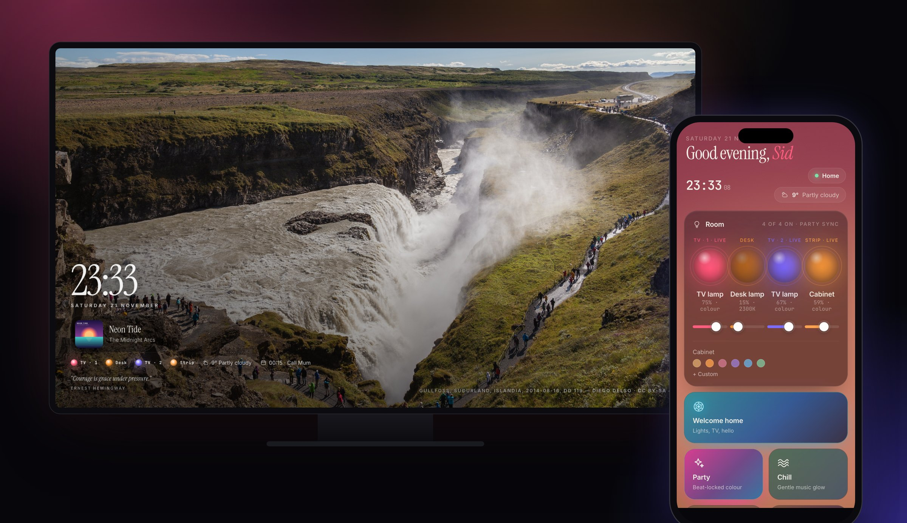
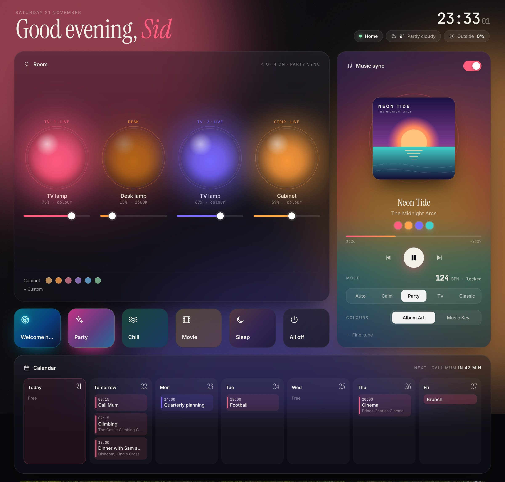
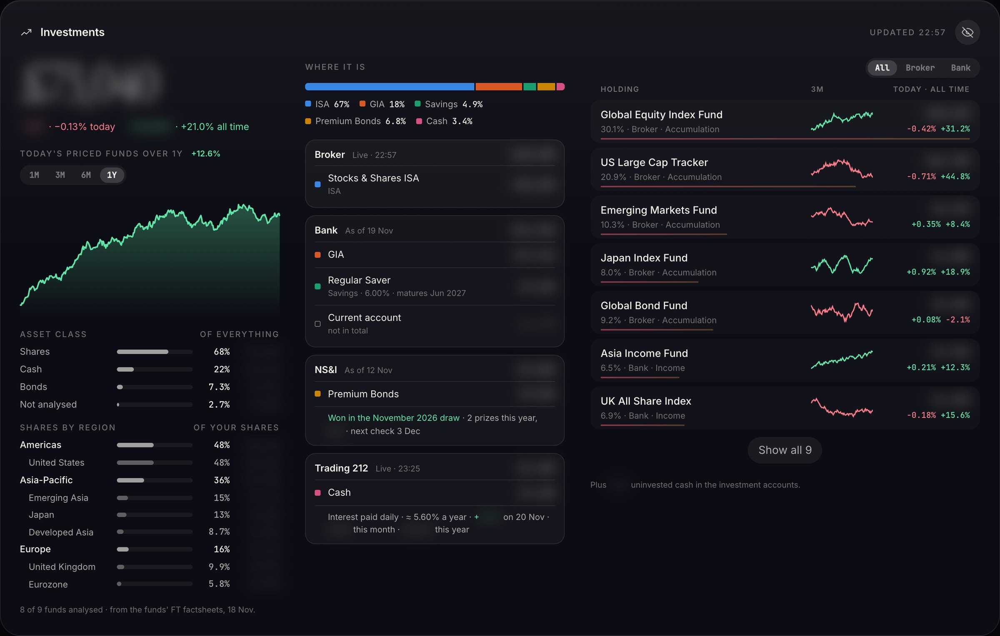
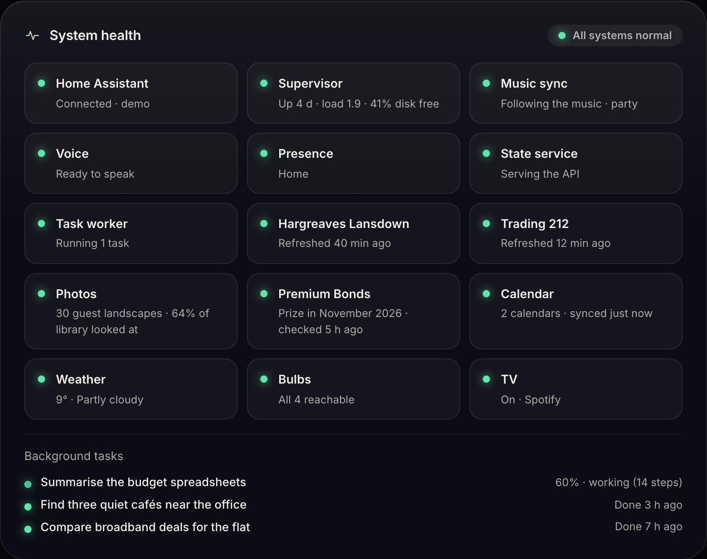
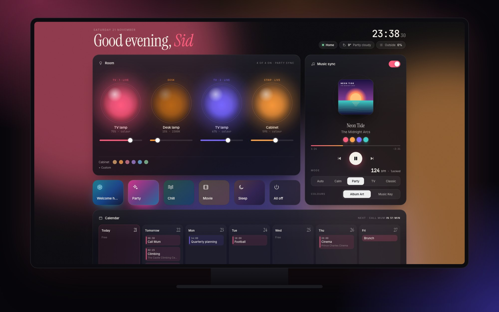
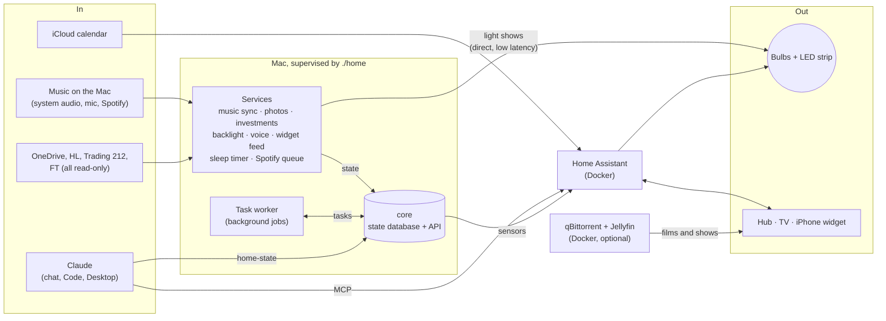

<p align="center"></p>

<p align="center">
  <b>The setup that runs my room in London.</b><br>
  Three WiZ bulbs, an LED strip, a TCL Google TV and a Mac, tied together with Home Assistant,<br>
  a handful of Python services, a central state API, and a dashboard built from scratch.
</p>

<p align="center">
  
  
  
  
  
  
</p>

<p align="center">
  <a href="#an-evening-with-it">Tour</a> &nbsp;·&nbsp;
  <a href="#the-hub">The Hub</a> &nbsp;·&nbsp;
  <a href="#everything-it-does">Features</a> &nbsp;·&nbsp;
  <a href="#how-it-fits-together">Architecture</a> &nbsp;·&nbsp;
  <a href="#running-it">Run it</a> &nbsp;·&nbsp;
  <a href="#deep-dives">Deep dives</a>
</p>

<br>

<p align="center"></p>
<p align="center"><sub>The TV's screensaver and the Hub on a phone. Every picture here is the Hub's demo mode: made-up data, nothing of mine.</sub></p>

<br>

## An evening with it

<table>
  <tr><td align="right" valign="top" nowrap><b>18:40</b></td><td>I get in and tap <b>Welcome home</b>. The lamps by the TV come up in blue, settle to warm white, and the TV wakes up and says <i>"Welcome home, Sid."</i></td></tr>
  <tr><td align="right" valign="top" nowrap><b>19:15</b></td><td>I put Spotify on. The two TV lamps and the strip behind the cabinet land on the beat, in colours that follow the music's key (or the album cover, if I ask).</td></tr>
  <tr><td align="right" valign="top" nowrap><b>20:30</b></td><td>I switch to Netflix. They drop to a dim warm glow that barely moves, so I stop noticing them.</td></tr>
  <tr><td align="right" valign="top" nowrap><b>22:30</b></td><td>The desk lamp has been following the sky all day. By now it's down to candle colour.</td></tr>
  <tr><td align="right" valign="top" nowrap><b>23:30</b></td><td>In bed, I pick a playlist and 45 minutes on my phone. It plays on the TV, the room glows warm and then goes dark, the screen turns almost black with just the minutes left, and the music fades out until the TV switches itself off.</td></tr>
  <tr><td align="right" valign="top" nowrap><b>any time</b></td><td>Leave the TV alone for a minute and it becomes a photo frame with a clock, what's playing and which lamps are on.</td></tr>
</table>

## The Hub

<p align="center"></p>

The dashboard is plain HTML and JavaScript on Home Assistant's websocket API, with no build step. The orbs are the
lamps in whatever colour they are right now, and the whole page takes its light from them. Below
the fold: the photo frame, every account in one place, the desk lamp's view of the sky, a remote for the TV and a
health card that says what's running and how fresh everything is. The music card shows Spotify's **Up next**: press
a song to jump to it, or search and add one.

<table>
  <tr>
    <td width="62%" valign="top"></td>
    <td width="38%" valign="top"></td>
  </tr>
  <tr>
    <td valign="top"><b>Money.</b> Every account from every provider, what it's invested in and where in the world, and each fund's price history. Every amount stays blurred until I tap the eye, as it is here.</td>
    <td valign="top"><b>Health.</b> Every service, data feed and device, and the background jobs Claude is running for me.</td>
  </tr>
</table>



**On the TV** the Hub is a native Android TV app (Kotlin and Compose for TV) with its own tile in the launcher: the
same cards as pages that each fit the screen, a rail on the left to move between them, big tiles for Netflix, Prime
Video, YouTube and Spotify (and Jellyfin, for the home's own films, once it's installed), a Sleep timer tile, and
the remote's focus moving with Google TV's own animations. The same app is the TV's **screensaver**, at the top of this page.

**On the phone** it's a home-screen web app in five pages you swipe between (Home, Music, Today, Money, Devices),
with a tab bar at the bottom, and an iPhone widget in the same style and a set of Shortcuts, so I can flip a lamp
without opening anything. Neither holds a Home Assistant password: they read a small feed and call
single-purpose webhooks that only work on my home network.

**And I can just ask Claude.** Home Assistant's MCP server gives it the lights, the TV, the scenes and the calendar,
so *"turn the TV lamps blue"* or *"lights out"* just works. Another set of tools gives it the home state itself, so
a Claude session looking after my finances can update the portfolio the Hub shows.

## Everything it does

<table>
  <tr>
    <td width="50%" valign="top"><br><b>Music sync</b><br><sub>Real beat tracking, a beat grid predicted ahead, so the lights land on the kick instead of lagging it. Listens to the Mac, or through the mic when the music comes out of the TV.</sub></td>
    <td width="50%" valign="top"><br><b>TV mode</b><br><sub>Bias lighting for watching things: warm white, very dim, nothing flashes. Brighter in a bright room, following the sun and the clouds.</sub></td>
  </tr>
  <tr>
    <td valign="top"><br><b>A desk lamp that follows the sky</b><br><sub>Colour and brightness from the sun, cloud and rain, winding down to candle light at night. Change it by hand and it leaves it alone for two hours.</sub></td>
    <td valign="top"><br><b>Welcome home, and a voice</b><br><sub>One button: lights, the TV, and a spoken hello through the TV in a British voice. Any automation can say something the same way.</sub></td>
  </tr>
  <tr>
    <td valign="top"><br><b>A Bluetooth strip, made a real light</b><br><sub>It only came with a phone app. The Mac holds the connection, so to everything else it's just another light, and it plays its own part in the music shows.</sub></td>
    <td valign="top"><br><b>Photos worth a wall</b><br><sub>A few good ones from 18,000 in OneDrive, picked on the Mac by looking at faces: people first, no lone selfies. Read-only, by construction and by test.</sub></td>
  </tr>
  <tr>
    <td valign="top"><br><b>Money in one place</b><br><sub>Hargreaves Lansdown (no API, so it logs in like the website, built so it can't lock the account), Trading 212, the bank, Premium Bonds prize checks, and each fund's asset and regional exposure.</sub></td>
    <td valign="top"><br><b>One state, one API</b><br><sub>A local database behind FastAPI holds everything the screens show, versioned and backed up, with scoped tokens for anything that writes to it.</sub></td>
  </tr>
  <tr>
    <td valign="top"><br><b>Background jobs</b><br><sub>"Go through these spreadsheets", "find a few good restaurants near X": each runs as a headless Claude Code session, tracked with its progress and result. Recurring jobs too.</sub></td>
    <td valign="top"><br><b>Claude, everywhere</b><br><sub>Ask for the lights in plain English, or let another Claude session read and update the home state through a skill or an MCP server.</sub></td>
  </tr>
  <tr>
    <td valign="top"><br><b>Falling asleep to music</b><br><sub>Pick a playlist and a length on the Hub, the TV or the phone: it plays on the TV through Spotify, the room winds down to a warm glow and then dark, the music fades out over the last ten minutes, and the TV switches itself off.</sub></td>
    <td valign="top"><br><b>Films and shows on the TV</b><br><sub>Torrents download into a library that the TV's Jellyfin app streams, sorted into films and series with their posters. All of it stays on the home network.</sub></td>
  </tr>
  <tr>
    <td valign="top"><br><b>Logs, metrics and traces</b><br><sub>Every service reports over OpenTelemetry to a local Grafana: health, errors, API latency and every log line, searchable.</sub></td>
    <td valign="top"><br><b>One switch</b><br><sub><code>./home up</code> and <code>./home down</code> start and stop everything, and a supervisor restarts anything that falls over.</sub></td>
  </tr>
</table>

## How it fits together



Home Assistant runs in Docker. The audio side can't, because it needs Core Audio and the mic, and neither can the
strip, because Docker on a Mac can't reach Bluetooth. So those services run natively on the Mac under a small
supervisor, and `./home` starts and stops the lot together. The strip is a Home Assistant light like any other: the
backlight service mirrors its state over Bluetooth, and during a show music sync drives it directly.

Shared state goes through `core`: services and other clients write to its API, it keeps the data in SQLite, and it
pushes what the screens need into Home Assistant. [docs/core.md](docs/core.md) has the design. Every service also sends its logs, metrics and
traces to a local Grafana ([docs/telemetry.md](docs/telemetry.md)). Each part's own detail, with diagrams, is in those
docs and in [CLAUDE.md](CLAUDE.md).

## Running it

```sh
python3 -m venv .venv && .venv/bin/pip install -r requirements.txt
cp .env.example .env                       # TOKEN = a Home Assistant long-lived token
./home up
.venv/bin/python -m homeassistant.apply    # pushes helpers, automations, dashboards and the Hub
```

The Hub is at `http://localhost:8123/hub-live`, or full screen at `/local/hub/index.html`. Turn on *Allow local
communication* in the WiZ app first. The first run asks for system audio, microphone and Spotify permissions.

```sh
./home up | down | restart | reload | status     # down puts the bulbs back before stopping anything
./home logs music_sync
bin/ha states light                              # quick look at anything in Home Assistant
bin/ha call script.turn_on script.welcome_home
tv-app/deploy                                    # build the TV app and install it on the TV
.venv/bin/python -m sleep login                  # once: the sleep timer's and Up next's own Spotify sign-in
.venv/bin/python -m media setup                  # once, with COMPOSE_PROFILES=media: torrents and Jellyfin
```

**Always on, from anywhere.** It can also run on a small Linux box (a mini PC on Debian) as an always-on server (systemd brings it back
after a reboot or a power cut), with the Mac only adding what needs a Mac (music sync, its voices), and the Hub
reachable from outside at a subdomain of your own through a Cloudflare Tunnel, with no router ports opened.
[server/README.md](server/README.md) is the step-by-step: `server/setup` and `server/check-hardware` on the server, `server/move-from-mac` and `server/use-server` on
the Mac.

## Deep dives

<details>
<summary><b>Music sync</b></summary>
<br>

`python -m music_sync` connects to Home Assistant and creates its own controls:

| Entity | |
| --- | --- |
| `input_boolean.music_sync` | On/off. The bulbs go back to how they were when it stops, after 30s of silence, or on the next run after a crash. |
| `input_select.music_sync_mode` | `auto`, `calm`, `party` (chases, strobes on drops), `tv`, `classic` (the original wiz_spotify algorithm). |
| `input_select.music_sync_colours` | `Music key` (default: colours follow the music) or `Album art`. |
| `input_number.music_sync_sensitivity` | Onset threshold. Up if it reacts to noise, down if it misses beats. |
| `input_number.music_sync_latency` | Sends beats this many ms early to cover bulb lag. Negative for Bluetooth speakers. |
| `sensor.music_sync_tempo` | Detected BPM and whether the beat grid is locked. |
| `sensor.music_sync_now_playing` | Track, cover, palette and playback position. |

The analysis (`analysis.py`, `show.py`) works on 23 ms STFT hops: spectral-flux onsets in three bands with adaptive
thresholds, tempo from autocorrelation, beat phase from a comb filter plus a PLL that nudges the grid towards
detected kicks. Once it's locked, beats are predicted and sent early. Hue comes from a chroma vector mapped onto the
circle of fifths, so it follows the key. There's per-band AGC and a simple breakdown-then-drop detector. Each bulb
is rate limited and identical updates are skipped.

Where it listens: `tv` mode always uses the mic. The other modes use the Mac's audio, but if that's silent for 3s
while the TV is on they switch to the mic (with a slow gain stage, since a laptop across the room hears the TV at
about -55 dBFS) and switch back after 1.5s of sustained Mac audio. Spotify's own state can't decide this, because the
Mac app says "playing" while it's acting as a remote for the TV.

Album colours: `nowplaying.py` asks Spotify over AppleScript what's playing (no developer account, and it won't
launch Spotify if it's closed). `palette.py` runs k-means on the cover, merges near-duplicate hues, throws out
black, grey and white and keeps up to four colours. `script.music_command` does play/pause/next/previous on the
Mac's Spotify if it's open, otherwise on the TV.

System audio comes from the bundled [audiotee](https://github.com/makeusabrew/audiotee) binary (MIT, macOS 14.2+).
Nothing is recorded; audio only lives in memory.

</details>

<details>
<summary><b>TV mode and the desk lamp</b></summary>
<br>

**TV mode** is warm white between 2200 and 2700K at 15% after dark. In daylight it rises to as much as 40%, following
the sun's height and the cloud cover, so the glow still shows in a bright room; changes fade in over about a minute. Loud scenes can push it up by at most 8 points over about 3
seconds, and it settles back over about 8. It listens to the room, so it works with every app, and it never times out
on quiet scenes. The *TV bias lighting* automation starts it when the TV turns on (unless music sync is already
running) and stops it when the TV turns off, and only on a real off-to-on change, otherwise every Home Assistant
restart would trigger it.

The **desk lamp** lives entirely in Home Assistant (`homeassistant/templates/`, `automations/desk_lamp_*.json`):

- `sensor.outdoor_daylight` estimates the light through the window from the sun's elevation (0 at -4°, full at 30°),
  cloud cover (up to -70%) and rain, fog or snow (another -20%).
- `sensor.desk_lamp_target_colour` is 4000-5200K during the day (cooler when it's overcast, to match the light
  outside), 2700K around sunset, and 2200K from the 21:00-22:30 wind-down until 05:00.
- `sensor.desk_lamp_target_brightness` scales to `input_number.desk_lamp_max_brightness`: the full value in the dark,
  less on bright days, 45% of it late at night, and at most 35% of it while the TV is on.

It only adjusts the lamp when it's already on. A manual change that's clearly off target pauses it for 2 hours.
Music sync never touches this bulb.

</details>

<details>
<summary><b>Welcome home and the voice</b></summary>
<br>

`homeassistant/scripts/welcome_home.json` is the sequence. WiZ bulbs can't do transitions, so the power-up is a
quick ramp of brightness steps in blue before they settle to 2700K, and the desk lamp comes on at its adaptive level.
If the TV was off it's switched on and the greeting plays through it, about 15 seconds after the press, most of
that the TV booting. If it was already on, the greeting comes from the Mac straight away, so it doesn't cut off
whatever's playing.

The voice is `announce/`. It speaks with macOS's own text to speech whenever Home Assistant fires a `home_say`
event, so any script or automation can say something. With `"target": "tv"` it renders the speech to a WAV under a
random name in `/local/announce/`, waits for the TV to wake, casts it, then closes the cast player. If the TV
doesn't come up, it says it on the Mac instead.

```json
{"event": "home_say", "event_data": {"text": "Goodnight, Sid.", "target": "tv"}}
```

It picks the most natural British voice installed. The built-in compact voices sound robotic; Apple's Premium
voices (System Settings > Accessibility > Spoken Content > Manage Voices, e.g. Jamie) sound far more human and are
picked up as soon as they're downloaded. Text goes to `say` as a plain argument, never through a shell.

</details>

<details>
<summary><b>The TV app and the screensaver</b></summary>
<br>

`tv-app/` is a native Android TV app (Kotlin, Jetpack Compose for TV) that talks to Home Assistant directly, with a
launcher banner, and is also the TV's screensaver (below). The web Hub has a TV mode of its own too: a 1280-wide canvas scaled to the screen, arrow-key
navigation to the nearest control in that direction (sliders take left and right), Back closing an open panel
before leaving the app, and the Hub's own TV remote hidden, since you're holding the real one. On Home
Assistant's one-off sign-in page the arrows step between fields. TV GPUs struggle with heavy blur, so TV mode also
swaps the frosted glass for near-solid cards. `?tv=1` shows TV mode in any browser.

The **screensaver** is the TV app's own (the same one as Home's Screensaver tile): your photos full screen,
cross-fading slowly, or the soft ambient glow when there are none, with the time, the date, what's playing, the
weather and the lights. The words drift a little each minute so nothing burns in, and it keeps going with the Mac
off (photos already on the TV). Google TV hides third-party screensavers in its settings,
but the setting underneath accepts any installed one, so it's switched over adb, with the original recorded first
so it can go back. The Hub's `?ambient=1` is the browser version of it.

```sh
tv-app/deploy                  # build with Gradle, install over adb and open it (TV_HOST in .env)
tv-app/deploy --no-open        # install without opening it, e.g. while someone's watching
tv-app/screensaver on | off | test | status
tv-app/screensaver delay 1     # start it after a minute idle
```

The TV needs Developer options with **Wireless debugging** on. Pair once with the code it shows
(`adb pair <tv>:<port> <code>`); after that `deploy` finds the TV by itself. The Hub's address is baked in at build
time, so redeploy if the Mac's address changes. Building needs JDK 17 and the Android SDK
(`brew install openjdk@17` and `brew install --cask android-commandlinetools`, then the platform and build tools
through `sdkmanager`).

</details>

<details>
<summary><b>The sleep timer and Spotify's Up next</b></summary>
<br>

`python -m sleep` runs the timer, started from the Hub, the TV app or the phone (`script.sleep_timer_start`, with a
playlist and a length). It wakes the TV if it's off, plays the playlist on it through Spotify Connect, and starts
`script.sleep_lights`: music sync off, then a warm glow stepping down to dark. Over the last ten minutes the volume
fades in a straight line; at the end the music pauses, the volume goes back to where it was, and the TV and lights
go off. The TV's own sleep timer is set over adb two minutes later, as a backup (the TCL setting
`tcl_app_power_off_time_delay` is in milliseconds). A running timer survives a restart. While it runs, the Hub and
the TV count down, the TV's screensaver becomes a near-black night screen with only the time left, and any button on
it opens the Music page to pause or cancel. +15 min and Cancel are on every screen.

`python -m spotify_queue` reports Spotify's queue to the Hub and handles `script.spotify_queue`: jump to a song in
it, search, add. Spotify's API can't remove or reorder queued songs. Both use their own Spotify sign-in
(`python -m sleep login`, after adding SPOTIFY_CLIENT_ID and SPOTIFY_CLIENT_SECRET from a Spotify developer app with
the redirect `http://127.0.0.1:8798/callback`), or Home Assistant's Spotify token until then. Playback control needs
Spotify Premium.

</details>

<details>
<summary><b>Films and shows: torrents to the TV</b></summary>
<br>

qBittorrent and Jellyfin, in `docker-compose.yml` under the `media` profile, both on the home network only. Torrents
added at `:8090` land in a library (MEDIA_DIR): the category `movies` in Movies, `shows` in Shows, anything else in
downloads, with unfinished files kept apart so a half-downloaded film never shows. Jellyfin (`:8096`) streams the
library to its Android TV app, which signs in with Quick Connect. `python -m media setup` does the rest once: the
folders, a real qBittorrent password (in data/secrets/), seeding limits, UPnP off, and Jellyfin's first-run wizard
and libraries. On the Linux server Jellyfin uses the graphics for any video the TV can't play as it is
([server/README.md](server/README.md), section 7).

</details>

<details>
<summary><b>Investments</b></summary>
<br>

HL doesn't have an API, so `investments/hl.py` logs in the way the website does and reads the portfolio pages. It's
a port of [hl-api-client-net](https://github.com/jonathanmadeley/hl-api-client-net). HL locks the account after a
few failed logins, so I was careful with this one:

- Credentials are checked locally first: the secure number has to be 6 digits and the date of birth has to be
  unambiguous.
- The password is only submitted if the page asks for exactly three secure-number digits it can identify.
- Any failed, interrupted or unexpected login stops automatic logins completely. Nothing retries. It stays stopped
  until `python -m investments login` works when run by hand.
- At most 8 automatic logins a day, and the session cookie is reused so most refreshes don't log in at all.

Price history for each fund comes from the FT's public fund pages (`investments/prices.py`), looked up by ISIN and
fetched once a day; only fund identifiers are sent to the FT. Clicking a holding opens its price chart with my
average cost marked, returns over each period and the position itself.

Trading 212 has an official API, so `investments/t212.py` just uses a read-only key and GET requests to read the cash
balance and the interest paid on it. If it ever refuses the key, it stops and doesn't retry, the same as the HL side.

```sh
.venv/bin/python -m investments setup        # HL details into the macOS Keychain
.venv/bin/python -m investments login        # one login by hand, then it refreshes hourly
.venv/bin/python -m investments setup-t212   # Trading 212 key and secret into the Keychain
```

The fetched holdings go to the central state service as snapshots (`portfolio/hl`, `portfolio/t212`), next to the
sources a Claude session keeps up to date for me, and core merges them into what the Hub shows. Hourly, holdings
written by hand with units and an ISIN are revalued from FT prices, with their price history for the charts.

**Exposure.** Once a week each fund's asset allocation and regional weightings come from its FT factsheet, and core
weights them by what I hold (savings and Premium Bonds count as cash), so the Hub can say how much is in shares,
bonds and cash, and where in the world the shares are.

**Premium Bonds.** NS&I's public prize checker is asked once each month's draw results are out, with only the holder
number, never a sign-in. A win shows on the Hub and raises a quiet notification.

None of it is exposed to Home Assistant's Claude or shown on the screensaver or the widget. `tests/test_investments.py` and
`tests/test_t212.py` run every safety rule against fakes.

</details>

<details>
<summary><b>Photos</b></summary>
<br>

There are about 18,000 photos in my OneDrive camera roll, and almost all of them are screenshots, receipts and
fifteen copies of the same sunset. `photos/` finds the few worth putting on a wall without downloading the library:

1. **List, don't download.** Microsoft Graph's delta query returns every photo's metadata (date, camera, size, lens)
   once, then only what changed. Screenshots, small images and anything without a camera are dropped here.
2. **Look at thumbnails.** A background job looks at 150 new candidates an hour: it fetches the ~800px thumbnail and
   runs face detection and recognition locally with OpenCV (YuNet and SFace). The thumbnail is thrown away; only the
   numbers are kept, in the central state, so the whole library gets looked at once, over a few days.
3. **Score.** Photos of me with other people come first, then other group photos, then everything else. A selfie
   only counts if someone's in it with me, and so does a single big face. Blurry, very dark and blown-out shots are out, and so is anything portrait.
4. **Pick.** About 40, at most two from any day, with a share from this month in past years, chosen at random by
   score so the set changes every few hours.

Only the photos in the current set are downloaded, at full resolution, and each new set avoids the one before.
They're converted from HEIC to JPEG with no location or camera data, and saved under random file names. Sign-in reuses an [rclone](https://rclone.org) remote with read-only scopes, so there's no Azure app to
register and it'll run the same on a Raspberry Pi.

```sh
rclone config                                   # add a OneDrive remote called "onedrive"
.venv/bin/python -m photos learn-me <photo>     # a photo of you, to recognise you
.venv/bin/python -m photos once                 # or let ./home run it every four hours
```

</details>

<details>
<summary><b>The central state, background jobs and Claude's tools</b></summary>
<br>

`core/` is one local service that owns the shared state: SQLite behind a FastAPI app on `127.0.0.1:8790`, with
interactive docs at `/docs`. Services report what they know to it, and it mirrors what the screens need into Home
Assistant, retrying until it lands and re-sending after a restart. Portfolio writes are immutable snapshots; other
state is versioned documents; every change is in an audit log that never holds amounts. It backs itself up daily and
checks its own integrity.

Background jobs are a queue in the same database, worked by `python -m core.worker`: leases, heartbeats, retries with
backoff, cancelling, schedules. An `agent` job is a headless `claude -p` in its own folder that can read only what
the job names and write only in its folder, with no shell unless asked and never anything that could touch OneDrive.

```sh
bin/task run "Summarise the spreadsheets in this folder" --dir ~/Documents/Budget
bin/install-skill claude 'doc/*' 'portfolio/*' 'price/*'    # the home-state skill for Claude Code, with a scoped token
bin/install-mcp                                             # the same tools in Claude Desktop's chat
```

[docs/core.md](docs/core.md) has the design, the schema and the API; [docs/telemetry.md](docs/telemetry.md) the
logs and metrics.

</details>

<details>
<summary><b>iPhone widget and Shortcuts</b></summary>
<br>

`widget/home.js` is a [Scriptable](https://scriptable.app) widget, so there's nothing to build or sign, in small,
medium, large and lock screen sizes. The `widget` service writes a small JSON feed every 20 seconds to a file under
Home Assistant's `/local/` folder whose name is a random secret: the three lights, what's playing, the TV, home or
away and the weather, and nothing else. `tests/test_widget.py` checks nothing outside that list can get in.

Tapping a bulb toggles it through a Home Assistant webhook. The webhooks are one automation, built from the same
local key rather than stored in the repo: secret, LAN-only, POST-only, each doing exactly one thing. A leaked address
can flip a lamp from my home network and nothing more, and deleting `data/widget/key` revokes all of them. iOS opens
Scriptable for a moment on every tap, so `python -m widget shortcuts` also makes signed Shortcuts for the lamps,
which run from the Shortcuts widget, the lock screen or Control Center without opening anything.

```sh
.venv/bin/python -m widget install --copy   # fills in the private address and copies the script to the clipboard
.venv/bin/python -m widget shortcuts        # signed Shortcuts, to AirDrop to the phone
```

Run the script once inside Scriptable for a check of what works. `node tests/widget_smoke.js` runs it against a
strict stand-in for Scriptable's API in every size, which catches typos but isn't the same as a real phone.

</details>

<details>
<summary><b>Claude, the calendar, the TV remote and the health card</b></summary>
<br>

**Claude.** Home Assistant's MCP server (`/api/mcp`) gives Claude the usual Assist tools. `homeassistant/voice.json`
decides which entities it can see and what they're called ("TV lamp 1", "desk light", "I'm home", "lights out").

```sh
claude mcp add-json -s user home-assistant \
  '{"type":"http","url":"http://localhost:8123/api/mcp","headersHelper":"'"$PWD"'/bin/ha-mcp-headers"}'
```

**Calendar.** iCloud over CalDAV, added by `homeassistant.apply` once `ICLOUD_USERNAME` and `ICLOUD_APP_PASSWORD` (an
app-specific password) are in `.env`. Clicking an event shows its details, with a map link and a join button for
video calls.

**TV remote.** The Hub's TV card has a D-pad, back and home, play/pause, mute, volume (hold to repeat), power and
buttons that open Netflix, YouTube, Spotify and the rest.

**Health card.** The supervisor publishes `sensor.system_health` every minute and whenever a service changes state.
The Hub combines it with how recently each feed refreshed and whether the bulbs, TV, weather and calendar are
reachable, and flags anything stale or down.

**Presence** (`python -m presence`, not running yet) would turn everything off when my phone has been off the Wi-Fi
for a while and the Mac is idle. It needs `PRESENCE_PHONE_MAC` in `.env`.

</details>

<details>
<summary><b>Home Assistant config</b></summary>
<br>

The parts of the config I care about are JSON in `homeassistant/`, pushed with `.venv/bin/python -m homeassistant.apply`.
I edit these rather than using the UI so the repo stays the source of truth.

| | |
| --- | --- |
| `helpers.json` | toggles, timers, sliders |
| `templates/` | daylight and desk lamp target sensors |
| `scripts/` | Welcome home, Party, Chill, Movie, Sleep (and its `sleep_lights`), All off, `music_command`, the sleep timer's start / cancel / extend, `spotify_queue` (Up next: add, jump, search) |
| `automations/` | TV lighting, desk lamp, manual hold, away |
| `dashboards/home.json` | the standard Home Assistant dashboard (`/home-hub`) |
| `voice.json` | what Claude can see and control |

</details>

## Layout

```
home                ./home up | down | reload | status | logs
stack/              the supervisor behind ./home, and the health it reports
music_sync/         audio capture, analysis, light show, now playing
announce/           the voice: speaks home_say events on the Mac or the TV
backlight/          the Bluetooth LED strip behind the cabinet
photos/             OneDrive photos: index, judge, pick, show
sleep/              the music sleep timer (Spotify on the TV, the room winding down, the TV's own timer)
spotify_queue/      Spotify's Up next for the Hub: the queue, jump to a track, search and add
media/              torrents (qBittorrent) into a library Jellyfin streams to the TV: python -m media setup
investments/        Hargreaves Lansdown, Trading 212, FT prices, fund exposure, Premium Bonds
core/               the central state: SQLite, the API, publishing to Home Assistant, the task worker
skills/home-state/  the Claude Code skill other sessions use to read and write the state
home_mcp/           the same for Claude: stdio for Desktop (bin/install-mcp), HTTP on the server (--http, token per request)
server/             the always-on Linux box: setup, check-hardware, move-from-mac, use-server, systemd unit
telemetry/          OpenTelemetry setup shared by every service, and the Grafana dashboard
widget/             the iPhone widget, its feed, webhooks and Shortcuts
tv-app/             the Android TV app and screensaver, and the scripts that deploy them
homeassistant/      Home Assistant config as code, and apply.py
frontend/hub/       the Hub (demo.js is its demo mode), plus screenshot.py and readme_images.py
presence/           phone on the Wi-Fi -> home or away
bin/                audiotee, ha, task, install-skill, install-mcp, check-commit, ha-mcp-headers
tests/              one suite per part: python -m tests.test_<part>
```

Every picture in this README comes from the Hub's demo mode (`?demo=1`, made-up data, nothing connected) and is
rebuilt with `.venv/bin/python frontend/readme_images.py`. The landscapes are from Wikimedia Commons, each credited on
screen under its own licence.

<p align="center"><sub>Built for one room. Public so others can borrow ideas; <a href="CLAUDE.md">CLAUDE.md</a> has the rules that keep anything personal out of it.</sub></p>
