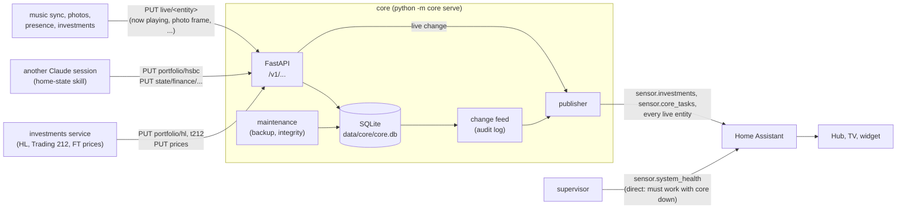
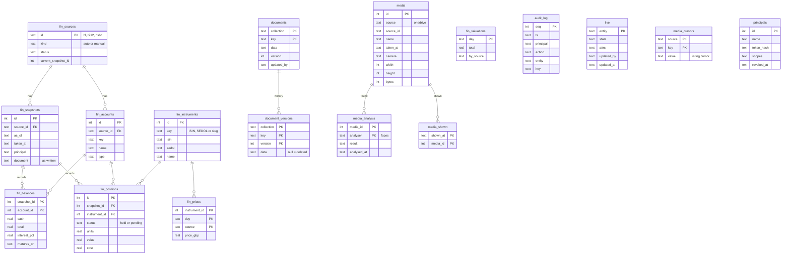
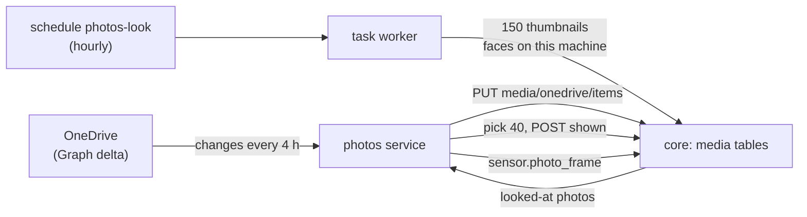
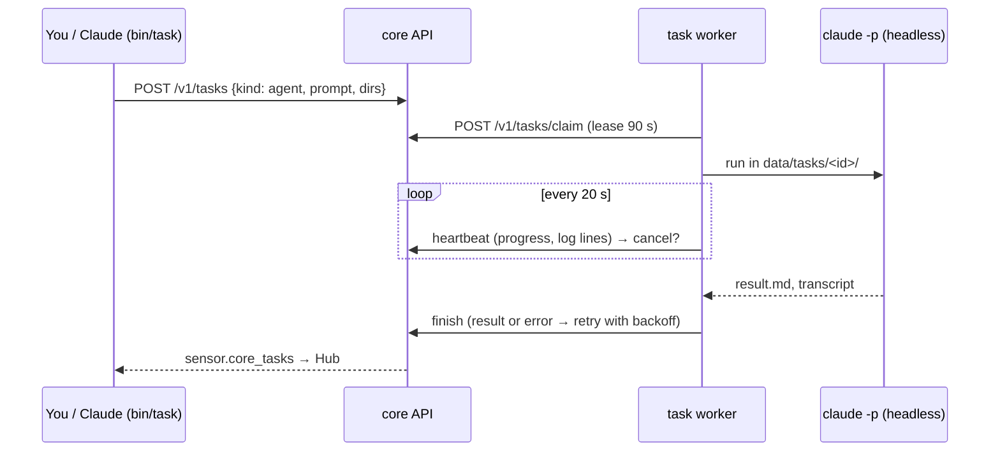

# core: the central state service

One local service owns the app's shared state. Services and other clients (another Claude session, a script)
change it through an HTTP API; it keeps the data in SQLite and pushes what the screens need into Home Assistant,
which carries it to the Hub, the TV and the widget.



## Why it's built this way

- **SQLite, one file.** No server to run, fast for this size, and it runs the same on a Raspberry Pi. WAL mode lets
  reads carry on during writes. The SQL keeps to what SQLite and Postgres share, so it can move if it ever needs to.
- **Snapshots, not edits, for money.** Writing a portfolio source stores an immutable snapshot of its full state.
  Nothing financial is overwritten, so any past state can be read back exactly, and positions can be queried across
  time from the normalised rows.
- **Prices kept apart.** A holding written by hand with units and an ISIN is revalued from the newest price at read
  time, so a background price update never conflicts with what a person or session wrote.
- **One audit log, three jobs.** Every change is appended to `audit_log` (who, when, what, counts not amounts). It's
  the audit trail, the change feed services follow (`GET /v1/changes?since=&wait=`), and what triggers publishing.
- **Home Assistant stays the bus to the screens.** The Hub, TV and widget already read Home Assistant, so core
  publishes there (debounced, retried, and re-published every 5 minutes because Home Assistant forgets REST-set
  states when it restarts). Nothing on the screens changed.

## Schema



`schema_migrations` records which numbered migrations in `core/db.py` have run; new tables arrive as new
migrations, applied at start. Migration 2 added `tasks`, `task_events` and `schedules` (below); migration 3 `live`
(the latest state of each entity the services report: no history, no audit, since it changes often); migration 4
the `media` tables (below).

## The API

FastAPI, so `/docs` is interactive and `/openapi.json` describes every call. Everything but `/v1/health` needs
`Authorization: Bearer <token>`.

| | |
|---|---|
| `GET /v1/portfolio` | every source now, plus the merged summary |
| `PUT /v1/portfolio/<source>` | a source's full current state: a new snapshot (unchanged: nothing written) |
| `PATCH /v1/portfolio/<source>` | `{"status": "paused" \| "ok", "paused_reason"}` |
| `GET /v1/portfolio/<source>/snapshots[/<id>]` | its history |
| `PUT /v1/prices/<instrument>` | a price in GBP for a day |
| `GET/PUT/PATCH/DELETE /v1/state/<collection>/<key>` | any other app state, versioned; `If-Match` for safe edits |
| `PUT /v1/live/<entity>` | a service reports `{"state", "attributes"}`; mirrored into Home Assistant (unchanged: nothing sent) |
| `GET /v1/live[/<entity>]` | what the services last reported |
| `GET /v1/media/<source>` | counts, listing cursors, the set shown last |
| `GET /v1/media/<source>/items?analyser=&analysed=&after=` | a page of items (5000), with that analyser's result |
| `PUT /v1/media/<source>/items` | a listing's changes: `{"items", "deleted", "cursor"}` |
| `PUT /v1/media/<source>/analysis/<analyser>` | `{"results": {id: result}}` |
| `POST /v1/media/<source>/shown` | `{"ids"}`: a set went on screen |
| `GET /v1/changes?since=&wait=` | the change feed (long-poll) |
| `GET /v1/audit` | who changed what |

The portfolio format is `core.portfolio.Source` (in `/openapi.json`, and in the skill's instructions).

## Access

- The services use `CORE_TOKEN` from `.env`, which may write anything.
- Every other client gets its own token with write scopes, matched against `doc/<collection>/<key>`,
  `portfolio/<source>`, `price/<instrument>`, `live/<entity>` and `media/<source>`: `python -m core token add finance 'portfolio/hsbc*' 'doc/finance/*'`.
  Tokens are stored hashed, can be revoked, and every write is logged under the token's name.
- It listens on 127.0.0.1 by default. On a Pi serving other devices, set `CORE_BIND` to its LAN address.

## Running and operating

```sh
python -m core serve                 # the supervisor runs it when CORE_TOKEN is set
bin/install-skill finance 'portfolio/hsbc*' 'portfolio/nsandi*' 'doc/finance/*'   # skill + a token for it
python -m core token list
```

Every hour it backs up the database (one file a day in `data/core/backups/`, 14 kept), runs an integrity check, and
optimises and checkpoints SQLite. `/v1/health` shows the results and when each publisher last succeeded.

## Media: the photo library

The photo library's index lives here: one `media` row per OneDrive photo (name, folder, when, camera, size; about
18,000 rows), what each analyser found (`media_analysis`, one row per photo and analyser, the result as JSON), every
set that went on screen (`media_shown`), and where the OneDrive listing got to (`media_cursors`). The images
themselves stay in OneDrive; the 40 on screen are downloaded, re-encoded and served from disk as before.



- **Progressive analysis.** Looking at photos is a background task (`photos-look`, hourly, 150 thumbnails), saving
  every 25, so it shows in the task list, can be cancelled, and a crash loses at most 25. The library gets looked at
  once; a photo whose file changes (a different size) loses its results and is looked at again.
- **Analysers are separate.** Results are keyed by analyser (`faces` now). A new kind of analysis (a caption, a
  scene label from a vision model) is a new analyser name and task kind, run over the same rows without touching the
  old results.
- **Policy stays in the client.** The core stores and filters; what's worth a look and what gets shown are the photos
  service's rules (`photos/__main__.py`), unchanged.
- The old `data/photos/index.json` was moved in once at start and kept as `index.json.migrated`.

## Live state: everything goes through the core

The services report what they know (`sensor.music_sync_now_playing`, `sensor.music_sync_tempo`, `sensor.photo_frame`,
`binary_sensor.someone_home`, `sensor.trading212`, `sensor.investment_<sedol>`) with `core.client.report(entity,
state, attributes)`. The core keeps the latest of each and its publisher mirrors it into Home Assistant: a burst
becomes one publish, a failure is retried with backoff, and everything is re-sent every 5 minutes and when the core
starts, so a Home Assistant restart no longer blanks a sensor until its service next reports. A report that changes
nothing is a no-op. Services read back their own state with `core.client.live(entity)` (photos uses this to decide
whether the frame shows the right set).

Deliberately not routed through the core:

- **Music sync's light frames** go straight to the bulbs and the strip over UDP, dozens a second: an extra hop
  would put the lights behind the beat. Its now-playing and tempo do go through the core.
- **The supervisor's `sensor.system_health`** is posted directly, because it has to report the core itself being
  down.
- **Reads of Home Assistant-owned state** (switches, the TV, weather, lights) stay with Home Assistant, the device
  layer. The Hub keeps reading Home Assistant until the API has a sign-in for browsers.

## Background tasks

Work that runs in the background and is tracked: ad-hoc jobs ("go through the spreadsheets in this folder and
summarise them", "find three good restaurants near X") and recurring ones (repricing holdings, hourly).



- The queue lives in `tasks` (with a lease, attempts, cancel flag, progress and result), `task_events` (the log, last
  500 lines a task) and `schedules` (which queue a task every N seconds, skipping a turn while the last is pending).
- The worker (`python -m core.worker`, supervised as `tasks`) only talks to the API, so more workers can run, on
  other machines too. A worker that dies loses its lease after 90 s and the task is claimed again.
- `agent` tasks run `claude -p` in their own folder, `data/tasks/<id>/`. They can read that folder and any `dirs`
  the task names, search and fetch the web, and write only inside their folder; no shell unless the task adds a
  tool (e.g. `Bash(python3:*)` for spreadsheets). The answer is in `result.md`, with the full transcript beside it.
- Built-in kinds: `revalue` (FT prices for hand-written holdings; scheduled hourly), `photos-look` (a batch of
  photos for faces; hourly) and `premium-bonds` (daily: NS&I's public prize checker with the holder number from
  .env, asked only once a month's results are due, 3 days after the draw, plus unclaimed prizes every 30 days;
  results in `doc finance/premium_bonds` and `sensor.premium_bonds`, beside the holding in `portfolio/nsandi`; a
  win raises a silent HA notification). New kinds are a function in
  `core/worker.py`'s HANDLERS.

```sh
bin/task run "Summarise the spreadsheets in this folder" --dir ~/Documents/Budget --tool 'Bash(python3:*)'
bin/task list | show <id> | cancel <id> | schedules
```
