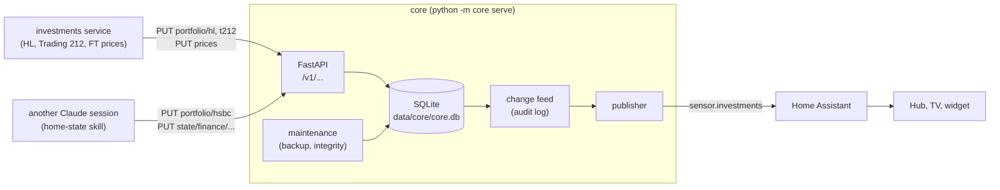
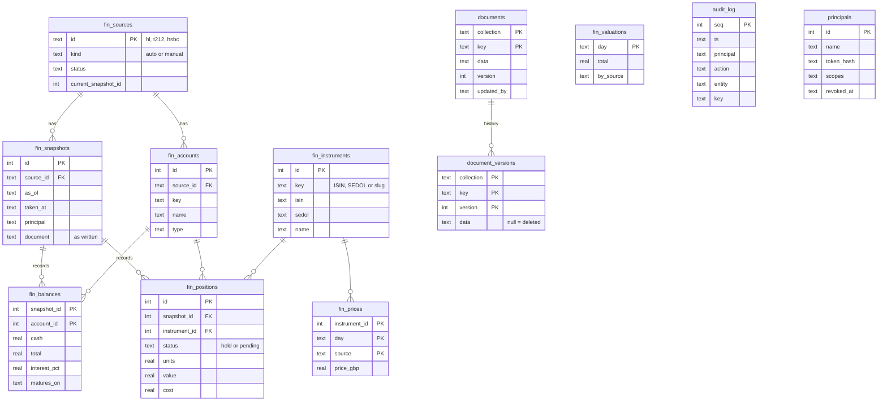

# core: the central state service

One local service owns the app's shared state. Services and other clients (another Claude session, a script)
change it through an HTTP API; it keeps the data in SQLite and pushes what the screens need into Home Assistant,
which carries it to the Hub, the TV and the widget.



## Why it's built this way

- **SQLite, one file.** No server to run, fast for this size, and it runs the same on a Raspberry Pi. WAL mode lets
  reads carry on during writes. The SQL keeps to what SQLite and Postgres share, so it can move if it ever needs to.
- **Snapshots, not edits, for money.** Writing a portfolio source stores an immutable snapshot of its full state.
  Nothing financial is overwritten, so any past state can be read back exactly, and positions can be queried across
  time from the normalised rows.
- **Prices kept apart.** A holding written by hand with units and an ISIN is revalued from the newest price at read
  time, so a background price update never conflicts with what a person or session wrote.
- **One audit log, three jobs.** Every change is appended to `audit_log` (who, when, what, counts not amounts). It's
  the audit trail, the change feed services follow (`GET /v1/changes?since=&wait=`), and what triggers publishing.
- **Home Assistant stays the bus to the screens.** The Hub, TV and widget already read Home Assistant, so core
  publishes there (debounced, retried, and re-published every 5 minutes because Home Assistant forgets REST-set
  states when it restarts). Nothing on the screens changed.

## Schema



`schema_migrations` records which numbered migrations in `core/db.py` have run; new tables arrive as new
migrations, applied at start. Planned next: a jobs table for the background task orchestrator, and media tables
for the photos (metadata and analysis results; the image files stay on disk, named by content hash).

## The API

FastAPI, so `/docs` is interactive and `/openapi.json` describes every call. Everything but `/v1/health` needs
`Authorization: Bearer <token>`.

| | |
|---|---|
| `GET /v1/portfolio` | every source now, plus the merged summary |
| `PUT /v1/portfolio/<source>` | a source's full current state: a new snapshot (unchanged: nothing written) |
| `PATCH /v1/portfolio/<source>` | `{"status": "paused" \| "ok", "paused_reason"}` |
| `GET /v1/portfolio/<source>/snapshots[/<id>]` | its history |
| `PUT /v1/prices/<instrument>` | a price in GBP for a day |
| `GET/PUT/PATCH/DELETE /v1/state/<collection>/<key>` | any other app state, versioned; `If-Match` for safe edits |
| `GET /v1/changes?since=&wait=` | the change feed (long-poll) |
| `GET /v1/audit` | who changed what |

The portfolio format is `core.portfolio.Source` (in `/openapi.json`, and in the skill's instructions).

## Access

- The services use `CORE_TOKEN` from `.env`, which may write anything.
- Every other client gets its own token with write scopes, matched against `doc/<collection>/<key>`,
  `portfolio/<source>` and `price/<instrument>`: `python -m core token add finance 'portfolio/hsbc*' 'doc/finance/*'`.
  Tokens are stored hashed, can be revoked, and every write is logged under the token's name.
- It listens on 127.0.0.1 by default. On a Pi serving other devices, set `CORE_BIND` to its LAN address.

## Running and operating

```sh
python -m core serve                 # the supervisor runs it when CORE_TOKEN is set
bin/install-skill finance 'portfolio/hsbc*' 'portfolio/nsandi*' 'doc/finance/*'   # skill + a token for it
python -m core token list
```

Every hour it backs up the database (one file a day in `data/core/backups/`, 14 kept), runs an integrity check, and
optimises and checkpoints SQLite. `/v1/health` shows the results and when each publisher last succeeded.
