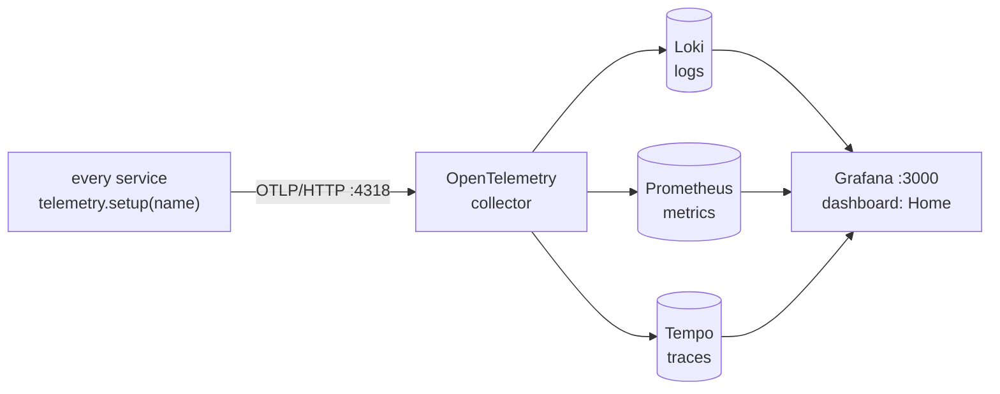

# Telemetry

Every service sends its logs, metrics and traces over OpenTelemetry (OTLP/HTTP) to one place. Locally that's the
`telemetry` container (Grafana's otel-lgtm image: Loki for logs, Prometheus for metrics, Tempo for traces, Grafana on
top), next to Home Assistant in docker-compose. Its data lives in `data/telemetry/`.

- **Grafana:** http://localhost:3000, the **Home** dashboard. It shows:
  - whether each service is up, plus restarts;
  - errors in the last hour, and tasks;
  - log volume, and warnings and errors, per service;
  - the core API's requests and latency;
  - how long since each publish to Home Assistant;
  - every log line, filterable by service and level and searchable.

  Traces of each API request are under Explore → Tempo.
- **What's measured:** `home.service.up` and `home.service.restarts` (supervisor), `home.tasks{status}`,
  `home.core.db_size`, `home.publish.age` (core), `home.tasks.finished` and `home.task.duration` (worker), and
  FastAPI's request metrics.
- **The per-service `*.log` files stay**, so nothing depends on the container being up.
- **Moving to a hosted backend** (Grafana Cloud, Honeycomb, anything that takes OTLP) is configuration: set
  `OTEL_EXPORTER_OTLP_ENDPOINT` and `OTEL_EXPORTER_OTLP_HEADERS` in `.env`, and `./home reload`.
- **Privacy:** logs leave each process now, so they must never contain amounts, tokens or personal text. Everything
  is bound to 127.0.0.1. Grafana's local admin is open to this machine only; on a Pi serving the LAN, set
  `GF_AUTH_ANONYMOUS_ENABLED=false` and a password first.
